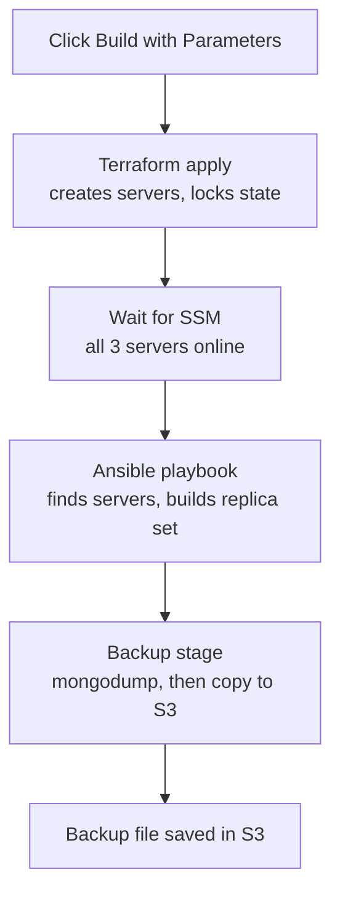

# MongoDB 3-Node Replica Set: Terraform + Ansible + Jenkins + SSM

A demo project that builds a highly available MongoDB replica set on AWS with one click.

- **Terraform** creates the servers, security group and IAM role.
- **Ansible** installs MongoDB, builds the replica set and takes backups.
- **Jenkins** runs everything from one pipeline.
- **AWS Systems Manager (SSM)** is used for access: no SSH, no key pair, no bastion host, no inbound ports.
- **Dynamic inventory**: Ansible asks AWS for the running servers on every run, so after
  `terraform destroy` and `terraform apply` the new instance IDs and IPs are picked up automatically.
- **Remote state**: Terraform state is stored in S3 and locked with DynamoDB.
- **Backups**: a Jenkins stage runs `mongodump` and uploads the file to S3.

> Demo only. MongoDB authentication is disabled and data lives on the root disk.
> Do not use this setup for real data.

## Architecture

```
                 Internet (apt, MongoDB repo)
                            ^
                            |
   S3 bucket  <------>  Internet gateway  <------>  SSM
 (state, backups)           ^
                            |
                   Route table (0.0.0.0/0 to IGW)
                            ^
 +------------------------ Default VPC ------------------------+
 |  Subnet AZ a         Subnet AZ b          Subnet AZ c        |
 |  [ mongo-1 ] <-----> [ mongo-2 ] <------> [ mongo-3 ]        |
 |   PRIMARY             SECONDARY             SECONDARY        |
 |        replication on port 27017, one security group        |
 +--------------------------------------------------------------+

 DynamoDB: Terraform state lock
```

| Part | Detail |
|---|---|
| Region | ap-south-1 |
| Network | Default VPC, 3 default subnets, security group allows port 27017 only between the nodes |
| Servers | 3 x t3.small, Ubuntu 22.04, IAM role for SSM and S3 |
| MongoDB | 7.0, replica set name `rs0` |
| Access | SSM Session Manager only |
| State | S3 bucket with DynamoDB lock |
| Backups | `mongodump` file uploaded to `s3://<bucket>/backups/` |

Traffic is outbound only. The servers have public IPs so they can reach the internet, SSM and S3, but no security group rule accepts traffic from the internet.

## Pipeline flow



| ACTION | What it does |
|---|---|
| `apply` | Builds everything, then takes a backup |
| `backup` | Takes a backup only (servers must be running) |
| `destroy` | Deletes the servers. Run `backup` first to keep the data |

## Project structure

```
mongodb-demo/
|-- Jenkinsfile              # pipeline: terraform, wait for SSM, ansible, backup
|-- .gitignore
|-- README.md
|-- terraform/
|   `-- main.tf              # backend, security group, IAM role, 3 servers
`-- ansible/
    |-- ansible.cfg          # uses the SSM connection
    |-- aws_ec2.yml          # dynamic inventory (reads live EC2 data)
    |-- site.yml             # installs MongoDB and builds the replica set
    `-- backup.yml           # mongodump and upload to S3
```

## How the automatic inventory works

Nothing about the servers is stored in a file. `ansible/aws_ec2.yml` queries the EC2 API on every run
and selects servers tagged `Project=mongo-demo` that are `running`.

| Variable | Source | Used for |
|---|---|---|
| `ansible_host` | instance ID | SSM connection target |
| `mongo_private_ip` | private IP | MongoDB bind address and replica set members |
| `ansible_aws_ssm_bucket_name` | `SsmBucket` tag | file transfer and backup bucket |
| `mongo_node_index` | `NodeIndex` tag | picks node 1 for replica set setup |

After `destroy` and `apply`, the new servers have new IDs and IPs, and the inventory finds them on its own.

## Prerequisites

On the machine that runs Jenkins (as the `jenkins` user):

- AWS credentials with rights for EC2, IAM, S3, DynamoDB and SSM
- Terraform, AWS CLI v2, `jq`
- Session Manager plugin
- A Python venv with Ansible and the AWS collections

```bash
sudo su jenkins -s /bin/bash
aws configure                      # region: ap-south-1
aws sts get-caller-identity        # must print your account

python3 -m venv /var/lib/jenkins/ansible-venv
source /var/lib/jenkins/ansible-venv/bin/activate
pip install --upgrade pip
pip install ansible-core boto3 botocore
ansible-galaxy collection install amazon.aws community.aws --force

curl "https://s3.amazonaws.com/session-manager-downloads/plugin/latest/ubuntu_64bit/session-manager-plugin.deb" -o ssm.deb
sudo dpkg -i ssm.deb
```

The default VPC must exist:

```bash
aws ec2 describe-vpcs --filters Name=isDefault,Values=true --region ap-south-1 --query 'Vpcs[0].VpcId'
# if it prints null:
aws ec2 create-default-vpc --region ap-south-1
```

## One-time setup: state bucket and lock table

Create these by hand once. They live outside Terraform on purpose, so `terraform destroy` never deletes your state or backups.

```bash
BUCKET=mongo-demo-sumit-12345        # must be unique worldwide, change the digits

aws s3 mb s3://$BUCKET --region ap-south-1
aws s3api put-bucket-versioning --bucket $BUCKET --versioning-configuration Status=Enabled

aws dynamodb create-table --table-name mongo-demo-lock \
  --attribute-definitions AttributeName=LockID,AttributeType=S \
  --key-schema AttributeName=LockID,KeyType=HASH \
  --billing-mode PAY_PER_REQUEST --region ap-south-1
```

Then put the same bucket name in `terraform/main.tf` in two places:
the `backend "s3"` block and `locals { bucket = ... }`.

## Run it from Jenkins

1. Create a **Pipeline** job named `mongo-demo`.
2. Pipeline definition: *Pipeline script from SCM*, Git, branch `*/main`, script path `Jenkinsfile`.
3. Click **Build with Parameters**, choose `apply`, and press **Build**.

The run takes about 6 to 8 minutes. At the end the console shows 1 PRIMARY and 2 SECONDARY, then the backup file in S3.

## Run it manually (without Jenkins)

```bash
source /var/lib/jenkins/ansible-venv/bin/activate   # or your own venv

cd terraform
terraform init
terraform apply

# wait about 2 minutes, then check all 3 are Online
aws ssm describe-instance-information --region ap-south-1 \
  --query 'InstanceInformationList[].[InstanceId,PingStatus]' --output table

cd ../ansible
ansible-inventory --graph
ansible-playbook site.yml
ansible-playbook backup.yml
```

## Demo: replication

Find the instance IDs:

```bash
aws ec2 describe-instances --region ap-south-1 \
  --filters "Name=tag:Project,Values=mongo-demo" "Name=instance-state-name,Values=running" \
  --query 'Reservations[].Instances[].[Tags[?Key==`Name`]|[0].Value,InstanceId,PrivateIpAddress]' \
  --output table
```

Open a session (no SSH) and check the members:

```bash
aws ssm start-session --target <instance-id> --region ap-south-1
mongosh --quiet
```
```javascript
rs.status().members.forEach(m => print(m.name + "  ->  " + m.stateStr))
```

On the PRIMARY:

```javascript
use shop
db.orders.insertOne({ item: "laptop", qty: 1 })
```

On a SECONDARY:

```javascript
db.getMongo().setReadPref("secondaryPreferred")
use shop
db.orders.find()
```

The document appears on the secondary. A write on a secondary fails with `not primary`.

## Demo: primary failover

Graceful switch, on the primary:

```javascript
rs.stepDown(60)
```

Crash simulation, in the primary's shell:

```bash
sudo systemctl stop mongod
```

On another node, run the status command again. After about 5 to 15 seconds another node becomes PRIMARY.
Insert a document there to show writes continue. Bring the old node back with `sudo systemctl start mongod`.
It rejoins as a SECONDARY and catches up.

Never stop two of the three nodes at once. Without a majority no primary can be elected.

## Demo: backup in S3

```bash
aws s3 ls s3://mongo-demo-sumit-12345/backups/ --region ap-south-1
```

Run the job with `ACTION = backup` again and a second file appears.

## Demo: remote state and lock

State file in S3:

```bash
aws s3 ls s3://mongo-demo-sumit-12345/mongo-demo/ --region ap-south-1
```

Lock in DynamoDB (run while Terraform is applying):

```bash
aws dynamodb scan --table-name mongo-demo-lock --region ap-south-1 --query 'Items[].LockID.S'
```

A second `terraform apply` started at the same time fails with "Error acquiring the state lock".

## Demo: rebuild with a fresh inventory

1. Run the Jenkins job with `ACTION = backup`, then `ACTION = destroy`.
2. Run it again with `ACTION = apply`.
3. In the console, `ansible-inventory --graph` lists the new servers and the replica set is rebuilt with the new IPs.
   No file was edited.

## Troubleshooting

| Symptom | Likely cause and fix |
|---|---|
| `NoCredentials` in Jenkins | The `jenkins` user has no AWS credentials. Run `aws configure` as `jenkins` |
| `ansible-inventory` shows no hosts | Servers not running yet, or the `Project=mongo-demo` tag is missing |
| Wait for SSM never finishes | A server is stopped or its agent is offline. Check EC2 state and the SSM list, then reboot it or destroy and apply again |
| Ping times out | SSM agent not online yet. Wait 1 to 3 minutes |
| `Cannot send input after starting communication` | Old system `community.aws`. Use the venv install above |
| `Error acquiring the state lock` | Another run is using the state, or a run crashed. Wait, or use `terraform force-unlock <id>` |
| Backup stage fails with `AccessDenied` | The bucket name in `main.tf` does not match in both places, or the IAM policy is missing |
| `git push` rejected, file over 100 MB | `.terraform/` was committed. Check `.gitignore` and remove it from Git |

## Cleanup

Run the job with `ACTION = destroy`. To remove the bucket and table as well:

```bash
aws s3 rb s3://mongo-demo-sumit-12345 --force
aws dynamodb delete-table --table-name mongo-demo-lock --region ap-south-1
```

If the bucket has versioning on, `rb --force` may leave old versions. Delete them in the S3 console first.
Also delete any IAM user and access key you created only for this demo.

## Known limitations (demo choices)

- No MongoDB authentication or TLS
- Data is on the root EBS disk and is deleted on destroy
- Single region, default VPC, public IPs for outbound traffic only
- The replica set is rebuilt from scratch on every apply. Restoring a backup is a manual step
